<p align="center">
    <a href="https://www.kotlinorm.com">
        
    </a>
</p>

---------

<h1 align="center">
    Kronos-ORM
</h1>

[English](https://github.com/Kronos-orm/Kronos-orm/blob/main/README.MD) | 简体中文

<h3 align="center">
为 Kotlin 设计的现代 ORM 框架。
</h3>
<div align="center">

Kronos 是基于编译器插件的 Kotlin ORM 框架。零反射、强类型、多数据库支持，支持在 JVM、Android/JVM 和 Kotlin/Native 应用间共享模型与查询。

[](http://kotlinlang.org)
[](https://github.com/Heapy/awesome-kotlin)
[](https://www.apache.org/licenses/LICENSE-2.0.html)

[](https://app.codacy.com/gh/Kronos-orm/Kronos-orm/dashboard?utm_source=gh&utm_medium=referral&utm_content=&utm_campaign=Badge_grade)
[](https://coverage.kotlinorm.com/kronos-compiler-plugin)
[](https://coverage.kotlinorm.com/kronos-core)
[](https://coverage.kotlinorm.com/kronos-syntax)
[](https://coverage.kotlinorm.com/kronos-codegen)

[](https://github.com/Kronos-orm/Kronos-orm/actions/workflows/kronos-kmp-testing.yml)

[](https://search.maven.org/search?q=g:com.kotlinorm)
[](https://central.sonatype.com/service/rest/repository/browse/maven-snapshots/com/kotlinorm/)

[官网](https://www.kotlinorm.com) | [中文文档](https://kotlinorm.com/#/documentation/zh-CN/getting-started/quick-start) | [Discord](https://discord.gg/Vn8EzxRX) | [QQ群](https://qm.qq.com/q/V821JzFUcM)
</div>

<p align="center">
  <a href="https://github.com/Kronos-orm/Kronos-orm/stargazers">
    
  </a>
</p>

--------

[Kotlin Multiplatform 配置与共享模型](https://kotlinorm.com/#/documentation/zh-CN/getting-started/kmp) · [Native SQLite 连接](https://kotlinorm.com/#/documentation/zh-CN/database/native-sqlite)

## 为什么选择 Kronos

- **零反射** — 编译器插件在构建期生成所有映射代码，无运行时开销，无 GC 压力。
- **Kotlin 原生 DSL** — 直接使用 `==`、`>`、`<`、`in`、`like` 编写条件，无需 `.eq()`、`.gt()`、`.lt()`。
- **多数据库** — 内置 MySQL、PostgreSQL、SQLite、H2、SQL Server、Oracle、DM8（达梦）方言。
- **功能完备** — 事务、级联（1:1 / 1:N / M:N）、表结构同步、序列化、跨库查询。
- **内置策略** — 逻辑删除、乐观锁、创建/更新时间戳，均可自定义。
- **框架与平台接入** — Spring Boot、Ktor、Vert.x、Solon、Android/JVM SQLite，以及 Apple、Linux 和 Windows 的 Native SQLite。
- **协程友好** — 从底层为结构化并发设计。
- **编译期映射** — KPojo 与 Map 互转，近乎零开销。
- **编译期类型投影** — `select`、`join`、`union` 都会暴露生成结果类型，字段和 alias 由 Kotlin 在编译期检查。
- **可组合查询** — 投影类型可以贯穿派生子查询、标量与谓词子查询、INSERT SELECT、CTAS 和 Union 查询层。

## 贡献者指引

使用 JDK 21 和仓库内的 Kotlin Toolchain wrapper 构建源码。`scripts/run` 会下载并校验 `libs.versions.toml` 选定的 Kotlin 脚本 SDK；Windows 使用 `scripts\run.cmd`：

```sh
scripts/run build bootstrap
scripts/run build build -m kronos-core -p jvm
scripts/run build test -m kronos-syntax -p jvm
scripts/run build test -m kronos-compiler-plugin -p jvm
scripts/run build test -m kronos-core -p jvm
```

`scripts/build.main.kts` 会从源码构建编译器插件，准备本地 Maven 仓库，再执行指定的 Kotlin Toolchain 命令。构建 Native 时选择目标，例如 `-p iosArm64`。

多模块构建由 `project.yaml` 声明。共享配置放在 `templates/`，本地 Toolchain 插件放在 `plugins/`，仓库命令放在 `scripts/`，编辑器集成测试放在 `kronos-testing/ide/`。各生产模块保留自己的 `module.yaml` 和测试。

安装官方 [Kotlin Toolchain IDE 插件](https://kotlin-toolchain.org/latest/getting-started/ide-setup/) 和 KEFS，再打开仓库中的 `project.yaml`。Toolchain 插件负责导入构建模型，KEFS 负责为编辑器分析加载 Kronos 编译扩展。Bootstrap 会将普通编译器坐标准备到 Maven Local 供导入使用，KEFS 兼容制品保留在 `build/repository/bootstrap`。共享的 `.idea/kotlin-plugins.xml` 已配置本地 bootstrap、Maven Central 和 snapshot 仓库。编辑器验证见 [IDE 集成测试](kronos-testing/ide/README.md)。

AI 编程助手可参考 `.agents/skills/` 下的技能指南获取架构与工作流上下文。

--------

## 快速示例

```kotlin
data class User(
    @PrimaryKey(identity = true) val id: Long? = null,
    val username: String? = null,
    val age: Int? = null
) : KPojo

dataSource.table.createTable<User>()

val id = User(username = "test", age = 18).insert().withId().execute().lastInsertId

val listOfUser = User().select().where { it.age == 18 }.toList()

User(id = id, age = 19).update().by { it.id }.execute()

User(id = id).delete().by { it.id }.execute()
```

## 投影与子查询示例

Kronos 为 Kotlin 查询加入了编译期生成投影类型，选出的 alias 可以被下一层查询继续消费。

```kotlin
val rankedOrders = Order()
    .select {
        [
            it.id,
            it.userId,
            it.amount,
            f.rowNumber()
                .over {
                    partitionBy(it.userId)
                    orderBy(it.createTime.desc())
                }
                .alias("rn")
        ]
    }
// 投影类型：{ id: Int?, userId: Int?, amount: BigDecimal?, rn: Long? }

val latestOrders = rankedOrders
    .select { [it.id, it.userId, it.amount] }
    .where { it.rn == 1 }
    .toList()
// 结果类型：List<{ id: Int?, userId: Int?, amount: BigDecimal? }>

val orderCounts = Order()
    .select { [it.userId, f.count(it.id).alias("orderCount")] }
    .groupBy { it.userId }
// 投影类型：{ userId: Int?, orderCount: Long? }

orderCounts
    .insert<UserOrderSummary> { [it.userId, it.orderCount] }
    .execute()

val activeUsers = User()
    .select { [it.id, it.name, it.status] }
    .where { it.status == ACTIVE }
// 投影类型：{ id: Long?, name: String?, status: Int? }

dataSource.table.createTable(UserArchive(), activeUsers)

val currentUsers = User().select { [it.id, it.name] }.where { it.enabled == true }
// 投影类型：{ id: Long?, name: String? }

val archivedUsers = ArchivedUser().select { [it.id, it.name] }
// 投影类型：{ id: Long?, name: String? }

val users = union(currentUsers, archivedUsers)
    .select { [it.id, it.name] }
    .toList()
// 结果类型：List<{ id: Long?, name: String? }>
```

## 环境要求

| 依赖 | 版本 |
|------|------|
| JDK | 8+ |
| Kotlin | 2.4.21+ |
| Gradle | Kotlin 2.4.21 支持的版本 |
| Maven | 3.9+ |

在 IntelliJ IDEA 中安装由 [Mr3zee](https://github.com/Mr3zee) 开发的 [Kotlin External FIR Support（KEFS）](https://plugins.jetbrains.com/plugin/26480-kotlin-external-fir-support)，并配置 Kronos 编译器插件组。完整步骤见 [编辑器支持](https://kotlinorm.com/#/documentation/zh-CN/resources/kefs)。

[版本记录](https://kotlinorm.com/#/documentation/zh-CN/resources/release-notes)

--------

## 安装

<details>
<summary><b>Gradle (Kotlin DSL)</b></summary>

```kotlin
plugins {
    kotlin("jvm") version "2.4.21"
    id("com.kotlinorm.kronos-gradle-plugin") version "0.4.0"
}

kotlin {
    compilerOptions {
        freeCompilerArgs.addAll("-Xcollection-literals", "-Xcontext-sensitive-resolution")
    }
}

dependencies {
    implementation("com.kotlinorm:kronos-core:0.4.0")
    implementation("com.kotlinorm:kronos-jdbc-wrapper:0.4.0")
    implementation("com.mysql:mysql-connector-j:<latest-stable>")
}
```

</details>

<details>
<summary><b>Gradle (Groovy)</b></summary>

```groovy
plugins {
    id 'org.jetbrains.kotlin.jvm' version '2.4.21'
    id 'com.kotlinorm.kronos-gradle-plugin' version '0.4.0'
}

kotlin {
    compilerOptions {
        freeCompilerArgs.addAll("-Xcollection-literals", "-Xcontext-sensitive-resolution")
    }
}

dependencies {
    implementation 'com.kotlinorm:kronos-core:0.4.0'
    implementation 'com.kotlinorm:kronos-jdbc-wrapper:0.4.0'
    implementation 'com.mysql:mysql-connector-j:<latest-stable>'
}
```

</details>

<details>
<summary><b>Maven</b></summary>

```xml
<project>
    <dependencies>
        <dependency>
            <groupId>com.kotlinorm</groupId>
            <artifactId>kronos-core</artifactId>
            <version>0.4.0</version>
        </dependency>
        <dependency>
            <groupId>com.kotlinorm</groupId>
            <artifactId>kronos-jdbc-wrapper</artifactId>
            <version>0.4.0</version>
        </dependency>
        <dependency>
            <groupId>com.mysql</groupId>
            <artifactId>mysql-connector-j</artifactId>
            <version>${mysql-connector-j.version}</version>
        </dependency>
    </dependencies>

    <build>
        <plugins>
            <plugin>
                <groupId>org.jetbrains.kotlin</groupId>
                <artifactId>kotlin-maven-plugin</artifactId>
                <version>2.4.21</version>
                <extensions>true</extensions>
                <configuration>
                    <args>
                        <arg>-Xcollection-literals</arg>
                        <arg>-Xcontext-sensitive-resolution</arg>
                    </args>
                    <compilerPlugins>
                        <plugin>kronos-maven-plugin</plugin>
                    </compilerPlugins>
                </configuration>
                <dependencies>
                    <dependency>
                        <groupId>com.kotlinorm</groupId>
                        <artifactId>kronos-maven-plugin</artifactId>
                        <version>0.4.0</version>
                    </dependency>
                </dependencies>
            </plugin>
        </plugins>
    </build>
</project>
```

</details>

### Android/JVM 和 SQLite

Android/JVM 接入由 `kronos-core`、Gradle 插件以及围绕 Android `SQLiteDatabase` 实现的 `KronosDataSourceWrapper` 组成。配置和 wrapper 说明见 [Android SQLite 指南](https://kotlinorm.com/#/documentation/zh-CN/database/android-sqlite)，完整应用见 [Android 示例](https://github.com/Kronos-orm/kronos-example-android)。

### Kotlin Multiplatform 和 Native SQLite

在 `commonMain` 共享 KPojo 模型与查询，通过 `KronosExecutionWrapper` 接入平台连接。[KMP 指南](https://kotlinorm.com/#/documentation/zh-CN/getting-started/kmp) 覆盖配置与初始化，[Native SQLite 指南](https://kotlinorm.com/#/documentation/zh-CN/database/native-sqlite) 和 [Native 参考应用](https://github.com/Kronos-orm/kronos-example-ios) 提供 Apple、Linux 和 Windows 连接示例。

## 支持的数据库

MySQL | PostgreSQL | SQLite | H2 | SQL Server | Oracle | DM8（达梦）

> Kronos 会根据当前数据库方言选择 SQL 渲染和表结构语句。

--------

## 使用

### 连接数据库

```kotlin
import com.kotlinorm.Kronos
import com.kotlinorm.connect

Kronos.connect(
    url = "jdbc:mysql://localhost:3306/kronos",
    userName = "root",
    password = "******",
    driverClassName = "com.mysql.cj.jdbc.Driver"
)
```

`Kronos.connect(...)`返回`KronosJdbcWrapper`并注册为默认数据源。

应用服务使用连接池时，添加所选连接池和JDBC Driver依赖后，可以直接提供其`DataSource`：

```kotlin
import com.kotlinorm.Kronos
import com.kotlinorm.wrappers.KronosJdbcWrapper

Kronos.dataSource = { KronosJdbcWrapper(SomeDataSource()) }
```

`KronosJdbcWrapper`也可以传入`databaseType = DBType.Mysql`和配置block。多数据源或动态数据源场景可以用`DriverManagerDataSource`创建独立wrapper，示例见[数据源包装器](https://kotlinorm.com/#/documentation/zh-CN/database/datasource-wrapper)。

### Android/JVM SQLite

Android 应用通过 `SQLiteDatabase` wrapper 配置 Kronos 数据源。完整接入见 [Android SQLite 指南](https://kotlinorm.com/#/documentation/zh-CN/database/android-sqlite)，可从 [参考 wrapper](https://github.com/Kronos-orm/kronos-example-android/blob/main/app/src/main/java/com/kotlinorm/example/android/AndroidSQLiteDataSourceWrapper.kt) 开始实现。

### 模型定义

```kotlin
@Table("tb_movie")
@TableIndex("idx_name", ["name"], "UNIQUE", "BTREE")
data class Movie(
    @PrimaryKey(identity = true)
    val id: Long? = null,
    @NonNull val name: String? = null,
    val directorId: Long? = null,
    @Cascade(["directorId"], ["id"])
    val director: Director? = null,
    val relations: List<MovieActorRelation>? = null,
    @Serialize
    val type: List<String>? = null,
    @Column("movie_summary")
    val summary: String? = null,
    @Version val version: Long? = null,
    @LogicDelete
    @Default("0") // @Default("false") for Postgres
    val deleted: Boolean? = null,
    @DateTimeFormat("yyyy-MM-dd HH:mm:ss")
    @UpdateTime val updateTime: String? = null,
    @CreateTime val createTime: LocalDateTime? = null
) : KPojo {
    var actors: List<Actor>? by manyToMany(::relations)
}
```

`@Serialize` 字段在两个方向都使用属性声明上的完整 `KType`。应用只需注册一个 serialized `ValueCodec`，对象、`List<String>`、嵌套 List 和 `List<Enum>` 都无需逐类配置。

```kotlin
import com.kotlinorm.Kronos
import com.kotlinorm.interfaces.serializedValueCodec
import kotlinx.serialization.KSerializer
import kotlinx.serialization.json.Json
import kotlinx.serialization.serializer

val json = Json {
    encodeDefaults = true
    ignoreUnknownKeys = true
}

val serializationRegistration = Kronos.registerValueCodec(
    serializedValueCodec(
        encode = { value, type ->
            @Suppress("UNCHECKED_CAST")
            val valueSerializer = serializer(type) as KSerializer<Any>
            json.encodeToString(valueSerializer, value)
        },
        decode = { text, type -> json.decodeFromString(serializer(type), text) }
    )
)
```

后注册的 codec 优先级更高；`serializationRegistration.close()` 只注销本次注册，主要用于测试或热更新。交给 Kotlinx Serialization 处理的 Kotlin data class 需要添加 `@kotlinx.serialization.Serializable`。完整 Gson 和 Kotlinx 示例见[序列化](https://kotlinorm.com/#/documentation/zh-CN/mapping/serialization)。

### 表操作

```kotlin
dataSource.table.exists<Movie>()
dataSource.table.createTable<Movie>()
dataSource.table.syncTable<Movie>()
dataSource.table.dropTable<Movie>()
```

### 查询

```kotlin
import com.kotlinorm.database.SqlExecutor.query

val users = User()
    .select { [it.id, it.username] }
    .where { it.id < 10 && it.age >= 18 }
    .distinct()
    .groupBy { it.id }
    .orderBy { it.username.desc() }
    .toList()
// 结果：List<{ id: Long?, username: String? }>

// 使用命名 PageResult 分页
val page = User()
    .select { [it.id, it.username] }
    .where { it.id < 10 && it.username like "a%" }
    .page(1, 10)
    .withTotal()
    .toList()
val total = page.total
val list = page.records
val totalPages = page.totalPages

// 联表查询
val usersWithRoles = User().join(UserRelation(), UserRole()) { user, relation, role ->
    leftJoin { user.id == relation.userId }
        .leftJoin { user.id == role.userId }
        .select {
            [user.id, user.username, relation.id.alias("relationId"),
                    role.role, f.count(1).alias("count")]
        }
        .where { user.id < 10 }
}.toList()
// 结果类型：List<{ id: Long?, username: String?, relationId: Long?, role: String?, count: Long? }>

// Union
val currentUsers = User()
    .select { [it.id, it.username] }
    .where { it.enabled == true }
// 投影类型：{ id: Long?, username: String? }

val archivedUsers = ArchivedUser()
    .select { [it.id, it.username] }
// 投影类型：{ id: Long?, username: String? }

val allUsers = union(currentUsers, archivedUsers).toList()
// 结果类型：List<{ id: Long?, username: String? }>

// 命名参数原生 SQL
val result = dataSource.query("select * from tb_user where id = :id", mapOf("id" to 1))
```

### 插入

```kotlin
user.insert().execute()
listOfUser.insert().execute()
```

### 更新

```kotlin
user.update()
    .set {
        it.username = "123"
        it.score += 10
    }
    .by { it.id }
    .execute()

user.update { [it.username, it.gender] }
    .by { it.id }
    .execute()
```

### Upsert

```kotlin
user.upsert { it.username }
    .on { it.id }
    .execute()

user.upsert { it.username }
    .onConflict()
    .execute()
```

### 删除

```kotlin
user.delete()
    .where { it.id == 1 }
    .execute()
```

--------

### KPojo 提供的方法

```kotlin
val instance = Movie::class.newInstance()

val dataMap: Map<String, Any?> = movie.toDataMap()
val movie2: Movie = dataMap.mapperTo<Movie>()

val tableName = movie.__tableName // 可读写
val tableComment = movie.__tableComment
val columns = movie.__columns
val indexes = movie.__tableIndexes
val createTime = movie.__createTime
val updateTime = movie.__updateTime
val logicDelete = movie.__logicDelete
val optimisticLock = movie.__optimisticLock

instance["fieldName"]
instance["fieldName"] = "value"
```

所有操作在编译期完成，无反射。

--------

## 框架集成

| 框架 | 示例 |
|------|------|
| Spring Boot | [kronos-example-spring-boot](https://github.com/Kronos-orm/kronos-example-spring-boot) |
| Ktor | [kronos-example-ktor](https://github.com/Kronos-orm/kronos-example-ktor) |
| Vert.x | [kronos-example-vertx](https://github.com/Kronos-orm/kronos-example-vertx) |
| Solon | [kronos-example-solon](https://github.com/Kronos-orm/kronos-example-solon) |
| Android/JVM + SQLite | [Android SQLite 指南](https://kotlinorm.com/#/documentation/zh-CN/database/android-sqlite) · [kronos-example-android](https://github.com/Kronos-orm/kronos-example-android) |
| iOS + SQLite | [iOS SQLite 指南](https://kotlinorm.com/#/documentation/zh-CN/database/native-sqlite) · [SwiftUI 示例](https://github.com/Kronos-orm/kronos-example-ios#run-the-ios-app) |
| Kotlin/Native + SQLite | [Native SQLite 指南](https://kotlinorm.com/#/documentation/zh-CN/database/native-sqlite) · [kronos-example-ios](https://github.com/Kronos-orm/kronos-example-ios) |

## AI 编程助手集成

Kronos 提供 AI 技能指南，帮助编程助手理解和生成 Kronos 代码。可以直接从 `main` 分支安装 skill：

| 工具 | 命令 |
|------|------|
| **Claude** | `npx degit Kronos-orm/Kronos-orm/.agents/skills/kronos-orm-guide#main .claude/skills/kronos-orm-guide` |
| **Codex** | `npx degit Kronos-orm/Kronos-orm/.agents/skills/kronos-orm-guide#main .codex/skills/kronos-orm-guide` |
| **Cursor** | `npx degit Kronos-orm/Kronos-orm/.agents/skills/kronos-orm-guide#main .cursor/skills/kronos-orm-guide` |
| **默认 / 通用** | `npx degit Kronos-orm/Kronos-orm/.agents/skills/kronos-orm-guide#main .agents/skills/kronos-orm-guide` |

如果目标目录已存在，在 `degit` 后添加 `--force`。

--------

## 文档

完整文档请访问[官方网站](https://www.kotlinorm.com)或[文档中心](https://kotlinorm.com/#/documentation/zh-CN/getting-started/quick-start)。

## 许可证

Kronos-ORM 遵循 [Apache 2.0 许可证](https://www.apache.org/licenses/LICENSE-2.0.html)发布。

## 贡献

参阅 [CONTRIBUTING.md](https://github.com/Kronos-orm/Kronos-orm/blob/main/CONTRIBUTING.md)。

## 贡献者

<a href="https://github.com/Kronos-orm/Kronos-orm/graphs/contributors">
  
</a>

-------------------

[](https://discord.gg/Vn8EzxRX)
[](https://qm.qq.com/q/V821JzFUcM)


